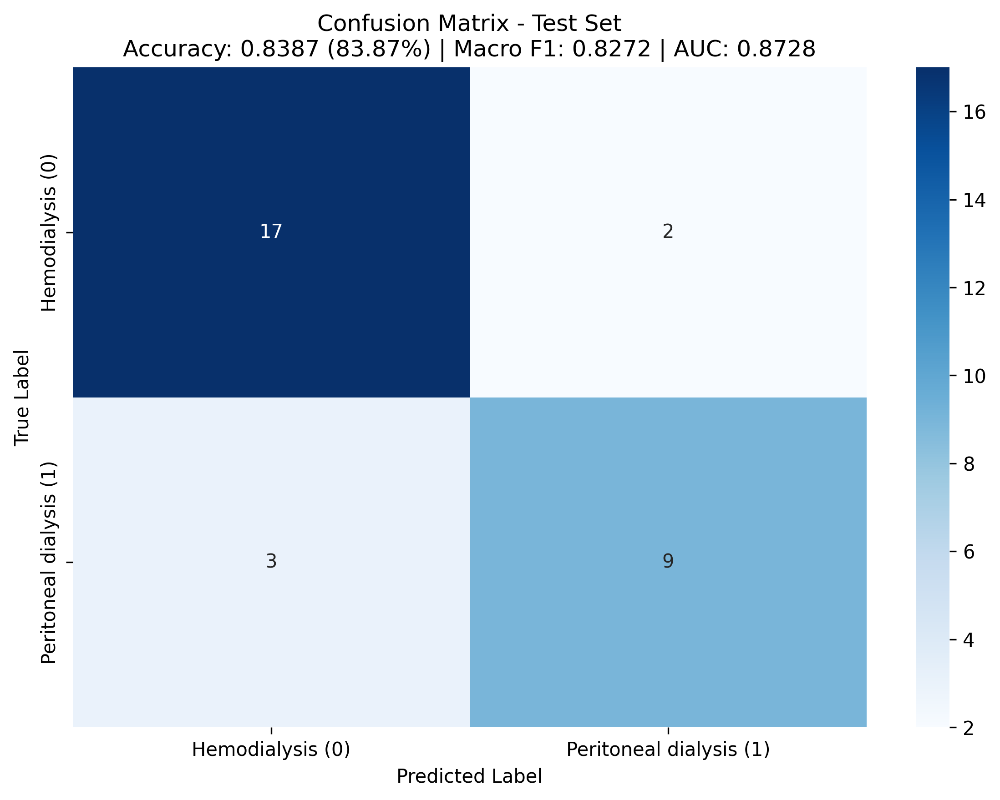
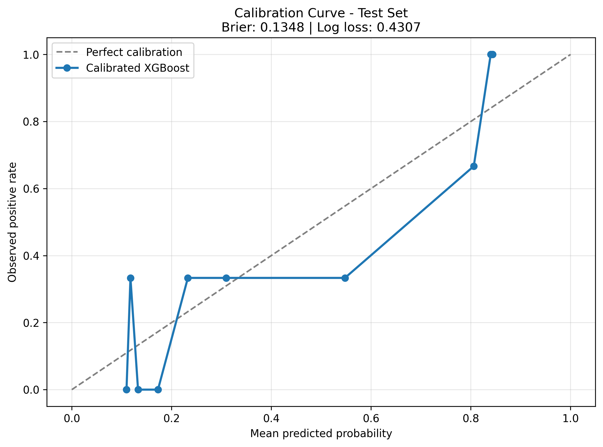
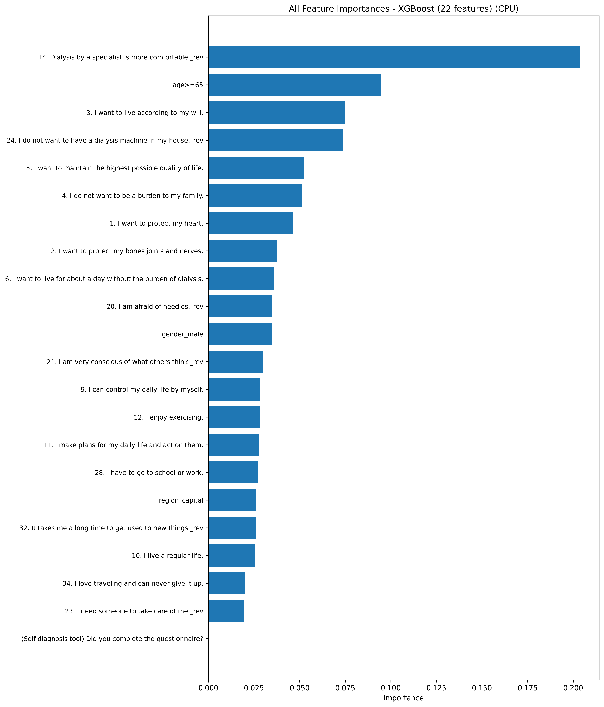

# MediSurveyBoost

만성콩팥병 환자의 **투석 방법 공유의사결정(Shared Decision Making)** 을 돕기 위한 설문 기반 예측 모델입니다.
환자가 교육 후 작성한 자가진단 설문 18문항만으로 **혈액투석 / 복막투석** 중 어떤 투석 방법을 선택하게 될지 예측하고,
예측 확률과 문항별 기여도(SHAP)를 함께 제공합니다.
나이·성별·거주 지역과 같은 보호 속성이 예측에 영향을 주지 않도록 **인과 개입(causal intervention) 기반 추론**을 적용합니다.

## 결과 요약

| 항목 | 단위 | 목표 | 성능 |
| :--- | :---: | :---: | :---: |
| 의료 알고리즘 정확도 | % | 80 | **83.87** |
| 의료 알고리즘 공정성 | 개별공정성(%) | 95 | **96.75** |

- 두 수치 모두 학습에 사용하지 않은 test set 기준입니다.
- 개별공정성은 **유사 환자 예측 일관성**으로 측정합니다. 정의와 계산 방법은 [개별공정성 평가](#개별공정성-평가)에 정리했습니다.

---

## 목차

1. [데이터 (SDM-ART)](#데이터-sdm-art)
2. [방법](#방법)
3. [인과 개입 기반 추론](#인과-개입-기반-추론)
4. [폴더 구조](#폴더-구조)
5. [환경 설정](#환경-설정)
6. [실행 방법](#실행-방법)
7. [결과](#결과)
8. [개별공정성 평가](#개별공정성-평가)

---

## 데이터 (SDM-ART)

**분당서울대학교병원의 "만성콩팥병 환자 투석방법 선택을 위한 공동의사결정 임상시험(SDM-ART)"** 데이터를 사용합니다.

> ⚠️ 실제 환자 데이터이므로 **이 저장소에는 데이터, 학습된 모델, 환자 단위 결과물이 포함되어 있지 않습니다.**
> 데이터를 취득하려면 분당서울대학교병원의 DRB / IRB 절차가 필요합니다.
> 저장소에는 전처리·학습·평가 코드와 집계 결과만 공개합니다.

임상시험은 환자를 고전적 대조군 / 공동의사결정군 / 집중 공동의사결정군으로 무작위 배정하고, Screening부터 Visit 7 / EoT(End of Trial)까지
인구통계, 검사 결과, 교육 후 설문(자가진단도구, 만족도, 삶의 질 등), 최종 투석·이식 여부를 기록합니다.

### 사용 데이터

| 구분 | 내용 |
| --- | --- |
| 원본 | eCRF 항목별 export (`C210033_20250731_항목별.xlsx`) |
| 정답(label) | `22_투석 및 이식` sheet. 혈액투석 = 0, 복막투석 = 1 |
| 입력(feature) | `14_설문지_교육 후 자가진단도구` sheet의 **Visit 7 / EoT** 응답 중 18문항 (Likert 1~5) |
| 보호 속성 | 나이(65세 이상 여부), 성별, 거주 지역(수도권 여부) — 학습 시 입력으로 사용하고, 추론 시에는 [인과 개입](#인과-개입-기반-추론)으로 영향을 제거 |

### 대상자 선정 과정

| 단계 | 인원 |
| --- | ---: |
| 투석 및 이식 기록 대상 환자 | 963 |
| 혈액투석 또는 복막투석을 시행한 환자 (신장이식, 미시행 제외) | 420 |
| 그중 Visit 7 / EoT 자가진단도구 설문을 작성한 환자 | 311 |
| 층화 분할이 불가능한 희소 조합 1명 제외 | 310 |
| **Train / Test (9 : 1, 층화 분할)** | **279 / 31** |

- 혈액투석과 복막투석이 모두 '예'인 경우 복막투석으로 간주합니다.
- 분할은 `label × 65세 이상 여부 × 지역(수도권/비수도권/미상)` 조합을 기준으로 층화했습니다 (`random_state=42`).

| 분포 | Train (279) | Test (31) |
| --- | ---: | ---: |
| 혈액투석 (0) | 170 (60.9%) | 19 (61.3%) |
| 복막투석 (1) | 109 (39.1%) | 12 (38.7%) |
| 65세 이상 | 32.3% | 32.3% |
| 남성 | 63.1% | 67.7% |
| 수도권 거주 | 49.8% | 48.4% |

### 입력 문항 (18문항)

자가진단도구 35문항 중 17문항을 제외한 18문항을 사용합니다. 제외한 문항에는 가족 구성·돌봄 여건처럼 편향을 유발할 수 있는 문항(22, 25, 26, 27, 33번)이 포함됩니다.
`역코딩` 표시 문항은 문항의 방향을 맞추기 위해 `6 - 응답값`으로 변환합니다.

| 번호 | 문항 | 역코딩 |
| ---: | --- | :---: |
| 1 | 나는 내 심장을 보호하고 싶다. | |
| 2 | 나는 나의 뼈, 관절과 신경을 보호하고 싶다. | |
| 3 | 나는 나의 의지대로 살고 싶다. | |
| 4 | 나는 내 가족에게 짐이 되고 싶지 않다. | |
| 5 | 나는 가능한 한 높은 삶의 질을 유지하고 싶다. | |
| 6 | 나는 하루 정도는 투석 부담 없이 지내고 싶다. | |
| 9 | 나는 내 스스로가 내 일상을 조절할 수 있다. | |
| 10 | 나는 규칙적인 생활을 한다. | |
| 11 | 나는 일상에 계획을 세우고 행동한다. | |
| 12 | 나는 운동을 즐긴다. | |
| 14 | 나는 전문가의 투석이 더 편하다. | ✓ |
| 20 | 나는 주삿바늘을 무서워한다. | ✓ |
| 21 | 나는 남의 눈을 많이 의식하는 편이다. | ✓ |
| 23 | 나는 나를 보살펴 줄 사람이 필요하다. | ✓ |
| 24 | 나는 투석기계를 내 집에 들여놓고 싶지 않다. | ✓ |
| 28 | 나는 학교에 가거나 직장에 다녀야 한다. | |
| 32 | 나는 새로운 것에 익숙해지기까지 시간이 많이 걸린다. | ✓ |
| 34 | 나는 여행을 좋아해서 절대 포기할 수 없다. | |

여기에 "자가진단도구 설문 작성 여부" flag 1개가 더해져 설문 입력은 총 19개 컬럼입니다 (최종 데이터에서는 모두 1).
학습 시에는 보호 속성 3개가 추가되어 22개 컬럼을 사용하고, 추론 시에는 설문 입력 19개만 필요합니다.
설문 결측값은 Likert 중간값인 3으로 채웁니다.

---

## 방법

```text
원본 eCRF export ──▶ 전처리 ──▶ XGBoost 학습 ──▶ 확률 보정 ──▶ 인과 개입 추론 ──▶ 예측 + 설명(SHAP)
                               (설문 + 보호 속성)  (sigmoid)   (보호 속성에 개입)    │
                                                                                  ├─▶ subgroup 성능 분석
                                                                                  └─▶ 개별공정성 평가
```

### 1. 모델: Calibrated XGBoost

- 환자 수가 수백 명 수준인 정형(tabular) 데이터에서 안정적이고, 문항별 기여도를 해석하기 쉬운 **XGBoost**를 사용합니다.
- XGBoost의 출력 점수는 "어느 쪽이 더 가능성이 높은지"는 잘 맞추지만 실제 확률과는 차이가 있습니다.
  환자와 의료진에게 "혈액투석 85% / 복막투석 15%"처럼 **확률로 제시**하기 위해 `CalibratedClassifierCV`(sigmoid, 5-fold, ensemble)로 확률을 보정합니다.

### 2. 공정성: 인과 개입 기반 추론

- 모델은 설문 응답과 함께 보호 속성(나이, 성별, 거주 지역)을 입력받아 학습합니다.
- 추론 시에는 환자의 실제 보호 속성을 쓰지 않고, 보호 속성에 **인과 개입(do-operator)** 을 적용한 예측을 학습 데이터의 분포로 가중 평균합니다.
- 그 결과 예측은 환자의 보호 속성 값에 따라 달라지지 않으며, 추론에 필요한 입력은 설문 응답뿐입니다.
- 자세한 방법과 효과는 [인과 개입 기반 추론](#인과-개입-기반-추론)에 정리했습니다.

이와 함께 다음을 수행합니다.

- **편향 유발 문항 제외**: 가족 구성·돌봄 여건 문항은 입력에 포함하지 않습니다.
- **층화 분할**: train / test를 `label × 65세 이상 여부 × 지역` 기준으로 나누어 두 집합의 집단 구성이 같도록 했습니다.
- **Subgroup 분석**: 나이, 성별, 지역별로 성능과 SHAP 기여도를 따로 확인합니다 (`posthoc_analysis.py`).
- **개별공정성 평가**: 유사한 환자가 같은 예측을 받는지를 정량화합니다 (`fairness_eval.py`).

### 3. 설명가능성

- 환자 한 명의 예측마다 SHAP waterfall plot과 문항별 기여도 표를 생성합니다 (`inference_single.py`). SHAP 값에도 같은 개입을 적용하므로 설명은 설문 문항만으로 구성됩니다.
- 전체 및 subgroup별 SHAP summary로 어떤 문항이 예측을 좌우하는지 확인합니다 (`posthoc_analysis.py`).

---

## 인과 개입 기반 추론

### 왜 필요한가

나이와 같은 보호 속성은 투석 방법 선택과 실제로 관련이 있어, 입력으로 사용하면 예측에 도움이 됩니다 (학습된 모델에서 나이는 두 번째로 중요한 입력입니다).
그러나 보호 속성을 그대로 입력하면 설문 응답이 같은 환자라도 나이·성별·지역에 따라 다른 추천을 받게 됩니다.
이 모델을 baseline으로 두고, 보호 속성의 영향을 줄이는 두 가지 방법을 비교했습니다.

| 방법 | 내용 |
| --- | --- |
| Baseline: 보호 속성을 그대로 입력 | 설문 응답이 같아도 보호 속성에 따라 예측이 달라짐 |
| 보호 속성을 입력에서 제외 | 보호 속성의 직접적인 영향은 없어지지만, 설문 응답이 보호 속성과 상관되어 있으면 그 영향이 설문 문항을 통해 간접적으로 학습될 수 있음 |
| **보호 속성을 입력하고 추론 시 인과 개입** | 학습 시 보호 속성의 영향을 설문 응답의 영향과 분리하고, 추론 시 그 영향을 제거 |

MediSurveyBoost는 인과 개입을 사용합니다.

### 방법

설문 응답을 $Q$, 보호 속성을 $A$ (65세 이상 여부, 성별, 수도권 거주 여부), 투석 방법을 $Y$ 라고 하겠습니다.

**1) 학습**: 설문 응답과 보호 속성을 모두 입력받는 모델 $f(Q, A) \approx P(Y = \text{복막투석} \mid Q, A)$ 를 학습합니다.

**2) 보호 속성 분포 추정**: 보호 속성 3개는 모두 0 / 1 값이므로 가능한 조합 $a$ 는 8가지입니다. 학습 데이터에서 각 조합의 비율 $P(A = a)$ 를 구해 모델과 함께 저장합니다.

**3) 추론 시 개입**: 환자의 설문 응답 $q$ 가 주어지면, 환자의 실제 보호 속성 대신 $A$ 를 8가지 조합으로 차례로 **강제**( $do(A = a)$ )하여 8개의 예측 $f(q, a)$ 를 구합니다.

**4) 분포 가중 평균**: 8개의 예측을 $P(A = a)$ 로 가중 평균한 값을 최종 예측 확률로 사용합니다.

$$
p(q) = \sum_{a} P(A = a) \cdot f(q, a)
$$

$p(q) \ge 0.5$ 이면 복막투석, 아니면 혈액투석으로 예측합니다.

이 식은 인과 추론의 **backdoor adjustment** 에 해당합니다. 보호 속성 $A$ 가 설문 응답 $Q$ 와 투석 방법 $Y$ 양쪽에 영향을 주는 공통 원인이라고 보고, $A$ 를 통해 생기는 연관성을 제거한 뒤 설문 응답이 투석 방법 선택에 미치는 영향만을 추정합니다.

**예시** (설명을 위한 가상의 경우, 보호 속성이 하나뿐이라고 단순화)

| 개입 | 학습 데이터에서의 비율 $P(A = a)$ | 개입한 예측 $f(q, a)$ |
| --- | :---: | :---: |
| $do(A = \text{65세 미만})$ | 0.7 | 0.60 |
| $do(A = \text{65세 이상})$ | 0.3 | 0.30 |

최종 예측 확률은 $0.7 \times 0.60 + 0.3 \times 0.30 = 0.51$ 입니다. 이 환자가 실제로 65세 미만이든 이상이든 같은 값이 나옵니다.

### 분포 가중 평균을 쓰는 이유

8가지 조합을 균등하게(각 1/8) 평균하는 방법도 있지만, 실제로는 조합마다 환자 수가 다릅니다.
균등 평균은 드문 조합의 예측에 실제 비중보다 큰 가중치를 주게 되고, 드문 조합일수록 학습 데이터가 적어 예측이 불안정합니다.
학습 데이터의 분포로 가중하면 실제 환자 구성을 반영한 평균이 되며, backdoor adjustment 식과도 일치합니다.

### 성질

- **보호 속성에 대한 불변성**: 설문 응답이 같은 두 환자는 나이·성별·지역이 달라도 항상 같은 예측을 받습니다.
- **추론 입력은 설문 응답뿐**: 실제 사용 시 환자의 나이·성별·지역을 입력받을 필요가 없습니다.
- **설명에도 동일하게 적용**: 문항별 SHAP 기여도 역시 같은 가중 평균으로 계산합니다.

### 효과

같은 XGBoost 설정과 확률 보정으로 세 가지 방법을 비교했습니다 (`compare_variants.py`). 보호 속성의 영향은 두 가지 지표로 측정합니다.

- **보호 속성 변경 시 예측 유지율**: 설문 응답은 그대로 두고 보호 속성만 다른 값으로 바꿨을 때 예측이 유지되는 비율입니다. 100%이면 예측이 보호 속성에 직접 의존하지 않습니다.
- **나이 집단 간 예측 차이**: 65세 이상 집단과 65세 미만 집단의 복막투석 예측 비율 차이입니다. 0에 가까울수록 두 집단이 비슷한 비율로 예측됩니다.

**고정 train / test 분할 (Test)**

| 방법 | Accuracy | Macro F1 | ROC-AUC | 개별공정성 | 보호 속성 변경 시 예측 유지율 |
| --- | :---: | :---: | :---: | :---: | :---: |
| Baseline: 보호 속성을 그대로 입력 | 83.87% | 0.8272 | 0.8947 | 97.21% | 94.93% |
| 보호 속성을 입력에서 제외 | 83.87% | 0.8272 | 0.8816 | 96.05% | 100.00% |
| **인과 개입 (최종)** | **83.87%** | **0.8272** | **0.8728** | **96.75%** | **100.00%** |

**분할 전 전체 데이터, 5-fold 교차검증 10회 반복 (평균 ± 표준편차)**

| 방법 | Accuracy | ROC-AUC | 개별공정성 | 보호 속성 변경 시 예측 유지율 | 나이 집단 간 예측 차이 |
| --- | :---: | :---: | :---: | :---: | :---: |
| Baseline: 보호 속성을 그대로 입력 | 84.79 ± 4.28% | 0.8989 ± 0.0430 | 96.81 ± 0.91% | 88.91 ± 3.58% | −42.62 ± 1.74%p |
| 보호 속성을 입력에서 제외 | 83.31 ± 3.63% | 0.8866 ± 0.0485 | 95.84 ± 0.89% | 100.00% | −32.01 ± 2.74%p |
| **인과 개입 (최종)** | **83.21 ± 4.03%** | **0.8853 ± 0.0465** | **96.35 ± 0.94%** | **100.00%** | **−30.65 ± 1.52%p** |

- **보호 속성에 대한 직접 의존 제거**: baseline은 설문 응답이 같아도 보호 속성만 바꾸면 예측이 달라지는 경우가 있습니다 (고정 분할 5.07%, 교차검증 평균 11.09%). 인과 개입을 적용하면 이런 경우가 없어집니다.
- **나이 집단 간 예측 차이 축소**: baseline의 −42.62%p가 인과 개입에서 −30.65%p로 줄어들며, 보호 속성을 입력에서 제외한 경우(−32.01%p)보다도 작습니다.
- **개별공정성**: 인과 개입 모델은 보호 속성을 입력에서 제외한 모델보다 높습니다 (고정 분할 96.75% vs 96.05%, 교차검증 96.35% vs 95.84%).
- **정확도**: 인과 개입 모델의 정확도는 보호 속성을 입력에서 제외한 모델과 같은 수준입니다.

구현은 [`src/smdart/causal_intervention.py`](src/smdart/causal_intervention.py)의 `CausalInterventionClassifier` 를 참고하세요.

---

## 폴더 구조

```text
medical_1/
├── README.md
├── src/smdart/
│   ├── train.py                   # 모델 학습 및 artifact 저장
│   ├── inference_single.py        # 단일 환자 예측 (+ SHAP)
│   ├── inference_test.py          # test set 전체 평가
│   ├── posthoc_analysis.py        # subgroup metric 및 SHAP 사후 분석
│   ├── fairness_eval.py           # 개별공정성 평가
│   ├── compare_variants.py        # 보호 속성 사용 방식 비교
│   ├── causal_intervention.py     # 인과 개입 기반 추론 모듈
│   └── check_gpu.py               # Docker GPU / XGBoost CUDA 확인
├── data_preprocessing/
│   └── data_preprocessing.ipynb   # 전처리 노트북
├── data/
│   ├── raw/                       # 원본 데이터 위치
│   └── processed/                 # 전처리 결과 위치
├── models/                        # 학습된 모델 위치
├── outputs/                       # 실행 결과 위치
├── assets/                        # README용 그림
├── Dockerfile
├── docker-compose.yml
├── environment.yml
├── environment-linux-64.lock
├── requirements.txt
├── requirements-docker.txt
└── MediSurveyBoost_v1/            # 이전 버전 코드
```

---

## 환경 설정

아래 명령은 모두 이 폴더(`medical/medical_1`)에서 실행합니다.

```bash
cd medical/medical_1
```

### 방법 A. pip (CPU만으로도 실행 가능)

```bash
conda create -n smdart python=3.10 -y
conda activate smdart
pip install -r requirements.txt
```

GPU가 없으면 스크립트가 자동으로 CPU(`hist`)로 학습합니다. 데이터가 작아 CPU로도 수 분 내에 끝납니다.

### 방법 B. conda (GPU용 XGBoost 포함)

```bash
conda env create -f environment.yml
conda activate smdart
```

### 방법 C. Docker (GPU)

NVIDIA GPU, 호환되는 host driver, Docker Engine, NVIDIA Container Toolkit이 필요합니다.

```bash
docker-compose build smdart-inference-test   # 이미지 빌드
docker-compose run --rm check-gpu            # GPU / XGBoost CUDA 확인
```

- `check-gpu` 는 XGBoost가 CUDA 없이 CPU로 fallback하면 실패하도록 구성되어 있습니다.
- Docker Compose v2 에서는 `docker-compose` 대신 `docker compose` 를 사용하면 됩니다.
- 컨테이너는 로컬의 `data/processed`, `models`, `outputs` 폴더를 마운트해서 사용합니다.

주요 패키지 버전: Python 3.10, xgboost 2.1.1, scikit-learn 1.3.2, pandas 1.5.3, numpy 1.24.4, shap 0.44.1

---

## 실행 방법

전체 흐름은 다음과 같습니다.

```text
0. 데이터 배치        data/raw/C210033_20250731_항목별.xlsx
1. 전처리             data_preprocessing/data_preprocessing.ipynb  →  data/processed/*.csv
2. 학습               src/smdart/train.py                          →  models/*.pkl, outputs/train/
3. Test set 평가      src/smdart/inference_test.py                 →  outputs/inference/test/
4. 단일 환자 추론     src/smdart/inference_single.py               →  outputs/inference/single/
5. 사후 분석          src/smdart/posthoc_analysis.py               →  outputs/posthoc/
6. 개별공정성 평가    src/smdart/fairness_eval.py                  →  outputs/fairness/
7. 방식 비교          src/smdart/compare_variants.py               →  outputs/comparison/
```

### 0. 데이터 배치

원본 데이터 파일을 `data/raw/` 에 둡니다. 자세한 내용은 [`data/raw/README.md`](data/raw/README.md)를 참고하세요.

```text
data/raw/C210033_20250731_항목별.xlsx
data/raw/transfer_cases.json     # (선택) 전원 대상자 ID 매핑
```

### 1. 전처리

```bash
pip install jupyter
jupyter notebook data_preprocessing/data_preprocessing.ipynb
```

노트북이 수행하는 작업:

1. 원본 Excel의 모든 sheet 로드, 전원 대상자 ID 통합
2. `모름` / `무응답` 및 sentinel 값(8888 등)을 결측으로 변환
3. `22_투석 및 이식` sheet에서 혈액투석(0) / 복막투석(1) label 생성
4. 나이·성별·거주 지역 메타데이터 생성 (지역명 표기 정규화 포함)
5. Visit 7 / EoT 자가진단도구에서 18문항 선택, 역코딩, 결측값 3으로 대체
6. 설문 작성자만 남기고 9 : 1 층화 분할
7. 국문 컬럼명 CSV/XLSX 및 영문 컬럼명 CSV(`*_eng.csv`) 저장

### 2. 학습

```bash
python src/smdart/train.py
# GPU 지정: CUDA_VISIBLE_DEVICES=0 python src/smdart/train.py
# Docker:   docker-compose run --rm smdart-train
```

- 입력: `data/processed/df_merge_train_diagnosis_18_eng.csv`
- 설문 응답 + 보호 속성으로 calibrated 모델 학습 → 보호 속성 분포 계산 → 인과 개입 추론 모델과 그림 저장
- 출력: `models/*.pkl`, `outputs/train/figures/`(confusion matrix, calibration curve, feature importance), `outputs/train/reports/`(subgroup 성능)

### 3. Test set 평가

```bash
python src/smdart/inference_test.py
# Docker: docker-compose run --rm smdart-inference-test
```

- Accuracy, Macro F1, ROC-AUC, Brier score, Log loss, confusion matrix를 calibrated / base 모델 각각에 대해 출력합니다.
- 출력: `outputs/inference/test/figures/`, `outputs/inference/test/reports/`(샘플별 예측, subgroup 성능), `outputs/inference/test/shap/`(샘플별 SHAP)

### 4. 단일 환자 추론

실제 서비스(UI) 연동을 가정한 스크립트입니다. 입력은 세 가지 방식 중 하나로 줄 수 있습니다.

```bash
# (1) 기본: test CSV의 첫 번째 행
python src/smdart/inference_single.py

# (2) CSV의 특정 행
SINGLE_INPUT_INDEX=3 python src/smdart/inference_single.py
SINGLE_INPUT_CSV=/path/to/patient_rows.csv SINGLE_INPUT_INDEX=0 python src/smdart/inference_single.py

# (3) JSON 문자열 또는 JSON 파일
SINGLE_INPUT_JSON='{"1. I want to protect my heart.": 5.0, "14. Dialysis by a specialist is more comfortable._rev": 2.0}' \
    python src/smdart/inference_single.py
SINGLE_INPUT_JSON=/path/to/patient.json python src/smdart/inference_single.py

# Docker
docker-compose run --rm smdart-inference-single
SINGLE_INPUT_INDEX=3 docker-compose run --rm smdart-inference-single
```

JSON의 key는 설문 문항의 영문 컬럼명(`data/processed/*_eng.csv` 의 header)을 사용합니다. 누락된 문항은 결측으로 처리됩니다.
보호 속성은 입력하지 않습니다.

출력 형식 (`outputs/inference/single/reports/single_prediction_result.json`, 아래 수치는 형식을 보여주기 위한 임의의 값):

```json
{
  "predicted_class": 0,
  "predicted_label": "Hemodialysis (0)",
  "probabilities_pct": {
    "Hemodialysis": "85.00%",
    "Peritoneal dialysis": "15.00%"
  }
}
```

SHAP waterfall plot과 문항별 기여도 표는 `outputs/inference/single/shap/` 에 저장됩니다. `ENABLE_SHAP=0` 으로 끌 수 있습니다.

### 5. 사후 분석

```bash
python src/smdart/posthoc_analysis.py
# Docker: docker-compose run --rm smdart-posthoc
```

나이 / 성별 / 지역 subgroup별 성능 지표, confusion matrix, SHAP summary를 `outputs/posthoc/` 에 저장합니다.

### 6. 개별공정성 평가

```bash
python src/smdart/fairness_eval.py                      # test split (기본)
FAIRNESS_SPLIT=train python src/smdart/fairness_eval.py # train | test | all
# Docker: docker-compose run --rm smdart-fairness
```

저장된 모델만 사용하며(재학습 없음), 결과를 `outputs/fairness/individual_fairness_{split}.json` 에 저장합니다.

### 7. 방식 비교

```bash
python src/smdart/compare_variants.py                        # 고정 train / test 분할
COMPARE_CV_REPEATS=10 python src/smdart/compare_variants.py  # + 전체 데이터 repeated 5-fold CV
# Docker: docker-compose run --rm smdart-compare
```

보호 속성을 그대로 입력한 모델, 입력에서 제외한 모델, 인과 개입을 적용한 모델을 같은 조건으로 학습해 비교하고 `outputs/comparison/` 에 저장합니다.

### 환경변수

| 변수 | 기본값 | 설명 |
| --- | --- | --- |
| `PROJECT_ROOT` | 이 폴더 | 프로젝트 루트 |
| `DATA_DIR` | `data/processed` | 전처리 CSV 폴더 |
| `MODEL_DIR` | `models` | model `.pkl` 폴더 |
| `OUTPUT_DIR` | `outputs` | 실행 결과 저장 폴더 |
| `SINGLE_INPUT_JSON` | - | 단일 추론 입력: JSON 문자열 또는 JSON 파일 경로 |
| `SINGLE_INPUT_CSV` | test CSV | 단일 추론 입력: CSV 파일 경로 |
| `SINGLE_INPUT_INDEX` | `0` | CSV에서 사용할 row index |
| `ENABLE_SHAP` | `1` | `0` / `false` / `no` 이면 단일 추론 SHAP 저장 비활성화 |
| `SHAP_TOP_N` | `15` | SHAP waterfall plot에 표시할 feature 수 |
| `FAIRNESS_SPLIT` | `test` | 공정성 평가 대상 split (`train` / `test` / `all`) |
| `COMPARE_CV_REPEATS` | `0` | 방식 비교에서 5-fold CV 반복 횟수 (`0` 이면 고정 분할만) |
| `XGB_DEVICE` | `cpu` | 방식 비교에 사용할 XGBoost device (`cpu` / `cuda`) |

---

## 결과

### 전체 성능

| 지표 | Test |
| --- | :---: |
| Accuracy | **83.87%** |
| Macro F1 | 0.8272 |
| ROC-AUC | 0.8728 |
| Brier score | 0.1348 |
| Log loss | 0.4307 |

Test confusion matrix:

| | 예측: 혈액투석 | 예측: 복막투석 |
| --- | :---: | :---: |
| **실제: 혈액투석** | 17 | 2 |
| **실제: 복막투석** | 3 | 9 |

<p align="center">
  
  
</p>

### 확률 보정의 효과 (Test)

| 모델 | Accuracy | Macro F1 | ROC-AUC | Brier score ↓ | Log loss ↓ |
| --- | :---: | :---: | :---: | :---: | :---: |
| Base XGBoost | 83.87% | 0.8272 | 0.8640 | 0.1392 | 0.4688 |
| **Calibrated XGBoost (최종)** | **83.87%** | **0.8272** | **0.8728** | **0.1348** | **0.4307** |

### Subgroup 성능 (Test)

| Subgroup | 인원 | Accuracy | Macro F1 |
| --- | ---: | :---: | :---: |
| 65세 미만 | 21 | 85.71% | 0.8571 |
| 65세 이상 | 10 | 80.00% | 0.4444 |
| 여성 | 10 | 80.00% | 0.8000 |
| 남성 | 21 | 85.71% | 0.8329 |
| 비수도권(미상 포함) | 16 | 87.50% | 0.8333 |
| 수도권 | 15 | 80.00% | 0.8000 |

- 모든 subgroup에서 정확도가 80% 이상입니다.
- 65세 이상 그룹은 인원이 10명이고 그중 복막투석 환자가 1명뿐이어서 Macro F1이 낮게 나옵니다.

### 중요 문항

<p align="center">
  
</p>

학습된 XGBoost의 feature importance 상위 항목은 다음과 같습니다.

1. 14번 "나는 전문가의 투석이 더 편하다." (역코딩)
2. 65세 이상 여부 (보호 속성)
3. 3번 "나는 나의 의지대로 살고 싶다."
4. 24번 "나는 투석기계를 내 집에 들여놓고 싶지 않다." (역코딩)
5. 5번 "나는 가능한 한 높은 삶의 질을 유지하고 싶다."

- 설문 문항 중에서는 투석을 전문가에게 맡기는 것이 편한지, 집에 투석기계를 두는 것을 받아들일 수 있는지처럼 **투석 방식 자체에 대한 선호**가 예측을 주도합니다.
- 보호 속성인 나이가 두 번째로 높게 나타납니다. 모델을 그대로 사용하면 나이에 따라 추천이 달라진다는 뜻이며, [인과 개입 기반 추론](#인과-개입-기반-추론)은 이 영향을 최종 예측에서 제거합니다.

---

## 개별공정성 평가

### 개별공정성이란

개별공정성(individual fairness)은 **"유사한 사람은 유사한 결과를 받아야 한다"** 는 원칙입니다.
집단공정성이 성별·연령대 같은 집단 사이의 평균적인 차이를 보는 것과 달리, 개별공정성은 환자 한 명 한 명에 대해
"이 환자와 거의 같은 환자가 있었다면 같은 추천을 받았을까?"를 묻습니다.

투석 방법 추천에서 이 원칙이 중요한 이유는 입력이 설문 응답이기 때문입니다.
5점 척도에서 "그렇다(4)"와 "매우 그렇다(5)"의 차이는 같은 환자라도 응답하는 날의 상태에 따라 달라질 수 있는 수준입니다.
이 정도의 차이로 추천 결과가 뒤바뀐다면, 사실상 같은 환자가 서로 다른 추천을 받는 셈이 됩니다.

### 지표: 유사 환자 예측 일관성

개별공정성 지표로 **유사 환자 예측 일관성(local consistency)** 을 사용합니다.

**"유사한 환자"의 정의**: 설문 18문항 중 **단 한 문항의 응답만 1점 다르고**, 나머지 17문항의 응답은 완전히 같은 가상의 환자.

**계산 절차**

1. 환자 $i$ 의 실제 응답 $x_i$ 로 모델의 예측 $f(x_i)$ (혈액투석 / 복막투석)를 구합니다. 예측에는 인과 개입 기반 추론을 그대로 적용합니다.
2. 문항 $q$ (18개)와 방향 $d \in \lbrace -1, +1 \rbrace$ 의 모든 조합에 대해, $q$ 번 문항의 응답만 $d$ 만큼 바꾼 유사 환자 $x_i^{(q,d)}$ 를 만듭니다.
   바꾼 응답이 척도 범위(1~5)를 벗어나는 경우는 실제로 존재할 수 없는 응답이므로 만들지 않습니다.
   (예: 이미 5점인 문항은 +1 방향의 유사 환자를 만들지 않음)
3. 유사 환자에 대해서도 같은 모델로 예측 $f(x_i^{(q,d)})$ 를 구합니다.
4. 모든 환자의 모든 유사 환자 쌍 가운데 예측이 일치하는 쌍의 비율을 계산합니다.

$$
\text{개별공정성}(\%) = \frac{\text{예측이 일치한 유사 환자 쌍의 수}}{\text{전체 유사 환자 쌍의 수}} \times 100
= \frac{\lvert \lbrace (i, q, d) : f(x_i) = f(x_i^{(q,d)}) \rbrace \rvert}{\lvert \lbrace (i, q, d) \rbrace \rvert} \times 100
$$

**예시** (설명을 위한 가상의 경우)

| | 14번 문항 | 나머지 17문항 | 모델 예측 |
| --- | :---: | :---: | :---: |
| 실제 환자 | 3점 | (응답 그대로) | 혈액투석 |
| 유사 환자 A | **2점** | 동일 | 혈액투석 → 일치 |
| 유사 환자 B | **4점** | 동일 | 복막투석 → 불일치 |

환자 한 명당 최대 36쌍(18문항 × 2방향)의 유사 환자가 만들어지며, 위와 같은 일치 / 불일치를 모든 쌍에 대해 집계합니다.

**해석**: 100%에 가까울수록 응답의 작은 차이에 추천이 흔들리지 않는다는 뜻입니다.
95%라면 "한 문항을 1점 다르게 답한 100가지 경우 중 95가지에서 같은 추천을 받는다"는 의미입니다.

### 결과

| Split | 환자 수 | 유사 환자 쌍 | 예측 일치 쌍 | 개별공정성 |
| --- | ---: | ---: | ---: | :---: |
| **Test** | 31 | 861 | 833 | **96.75%** |
| Train | 279 | 7,752 | 7,526 | 97.08% |

### 재현 방법

```bash
python src/smdart/fairness_eval.py                      # test
FAIRNESS_SPLIT=train python src/smdart/fairness_eval.py # train
```

구현은 [`src/smdart/fairness_eval.py`](src/smdart/fairness_eval.py)의 `local_consistency()` 를 참고하세요.
